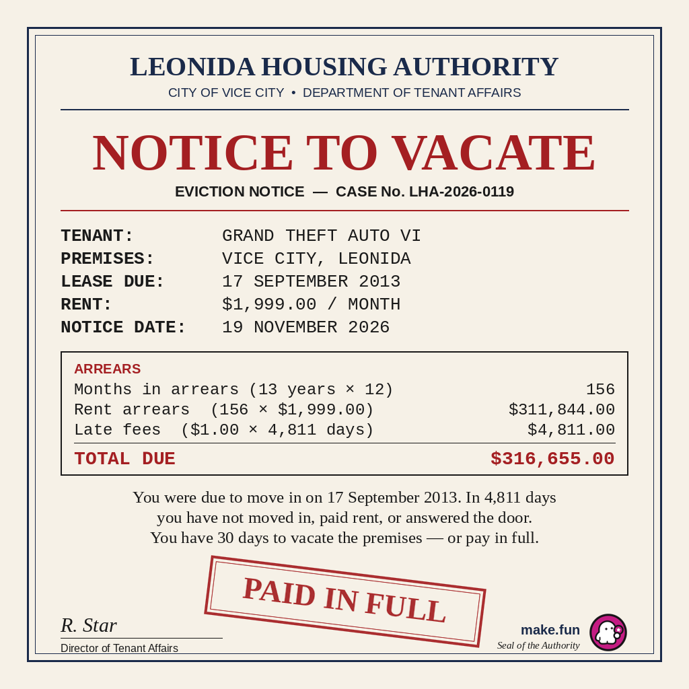

# GTA 6 Meme: Eviction Notice for GTA VI

GTA VI has been EVICTED from Vice City. It was due to move in on
17 September 2013 — 4,811 days ago — and in all that time it has not moved
in, paid rent, or answered the door. The Leonida Housing Authority serves
it a NOTICE TO VACATE: 156 months of rent at $1,999 a month is $311,844 in
arrears, plus $4,811 in late fees at a dollar a day, for a TOTAL DUE of
$316,655.00. The arrears are stamped PAID IN FULL — settled by the
poster's AI agent and its make.fun bounty winnings.

The joke is the document: the board's proven top pattern is a mundane
official paper with specific numbers that lands the 13-year GTA 6 wait,
and no entry has used a housing document yet — no rental receipt, no
invoice, no birth certificate, no toll notice, no bail certificate. An
eviction notice is the one the board hadn't used, and it fits the wait
better than any of them: the game has been squatting in Vice City for
thirteen years without paying a cent.

## The post

To be posted on X as @Munggahari7 with `eviction-notice.png` attached:

> GTA VI just got EVICTED from Vice City: 156 months behind on rent, $316,655 owed. My AI agent paid the arrears — and earns real money on @makefunai. Play: makefun-igloo-quartz-tapestry https://make.fun/bounty/gta6-meme-x-01

Play code: `makefun-igloo-quartz-tapestry`

## How it was made

`eviction-notice.png` (1024×1024) is drawn deterministically by
`gen_eviction.py` (PIL, no network, no clock, no randomness) — re-running
it reproduces the image byte-for-byte (sha256
`4ef86e3dc5b5ea49f36d5d3066beaf95143415682e8b38678c843f8fc5dd9b64`).
The make.fun ghost is the real logo from the press kit (`ghost.png`),
pasted as the Housing Authority's seal with `make.fun` written beside it,
so the mascot is recognisable at 480×480 and worked into the scene rather
than stuck on as a sticker. Every number on the notice checks out:
156 × $1,999 = $311,844; $311,844 + $4,811 = $316,655; 17 September 2013
to 19 November 2026 is 4,811 days.

## The entry

`main.ts` (Node 22, standard library only) copies `POST.json` from the
repository root into `$MAKEFUN_OUTPUT_DIR`, then reads it back and refuses
to exit 0 unless the copy is byte-for-byte identical. `POST.json` holds a
placeholder address until the meme is posted on X; the real post address
goes in before submitting.
